<div align="center">
  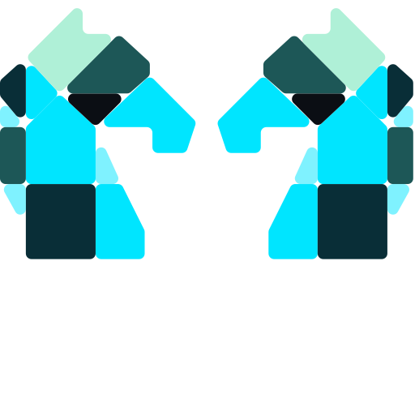
  <h1>MOSAIC</h1>
  <p>A modern chess app for Android: rated online games, bots, daily puzzles, tournaments, clubs and a friendly community, all in one place.</p>
  <p>
    <a href="https://kotlinlang.org/">Kotlin</a> ·
    <a href="https://developer.android.com/jetpack/compose">Jetpack Compose</a> ·
    <a href="https://firebase.google.com/">Firebase</a> ·
    <a href="https://developer.android.com/">Platform</a> ·
    <a href="#getting-started">Min SDK</a>
  </p>
  <p>
    <a href="#screenshots">Screenshots</a> ·
    <a href="#features">Features</a> ·
    <a href="#architecture">Architecture</a> ·
    <a href="#tech-stack">Tech stack</a> ·
    <a href="#getting-started">Getting started</a>
  </p>
</div>

## Overview

MOSAIC is a native Android chess app built with Kotlin and Jetpack Compose. You can play rated games against people around the world, challenge a friend with a link or QR code, practise against bots, train with daily puzzles, join tournaments and clubs, and review every game with an analysis board.

- **Play:** rated matchmaking in Bullet, Blitz, Rapid and Classical, daily games, bot games, pass and play on one device, friend challenges by link or QR code, and live spectating.
- **Train:** a daily puzzle, Puzzle Rush, Survival, Mini Mates, custom tactics by theme and rating, and a full game analysis with an evaluation graph and key moves.
- **Belong:** friends, direct messages, clubs with their own chat and leaderboard, tournaments (Swiss, Round Robin, Knockout), a community feed, a nearby players map and global leaderboards.
- **Make it yours:** 8 board themes, 5 piece sets, home screen widgets and a mascot that reacts to your games and puzzles.

The app talks to a MOSAIC game server over REST and WebSockets. It keeps a local cache so recent data is still shown when you go offline.

## Screenshots

### Home and play

<table>
  <tr>
    <td align="center">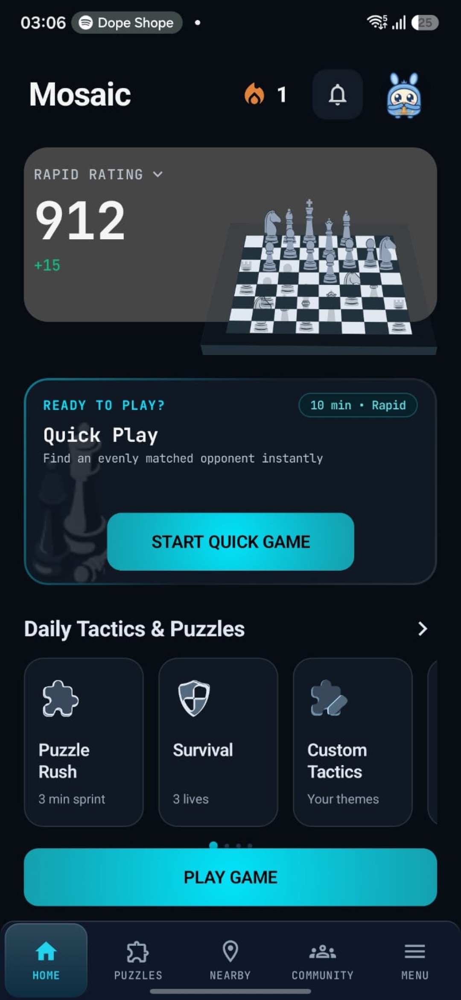</td>
    <td align="center">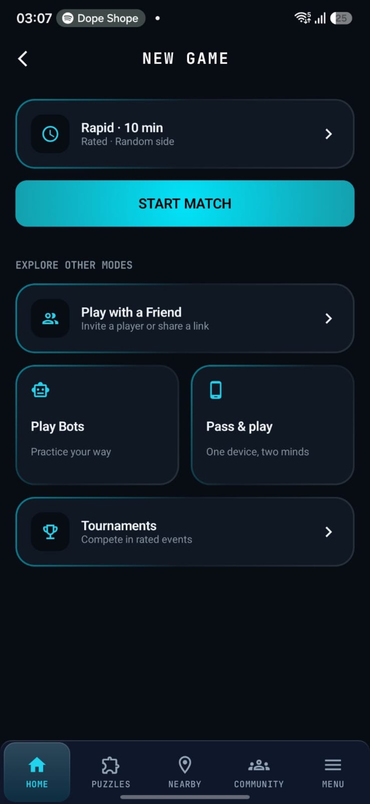</td>
    <td align="center">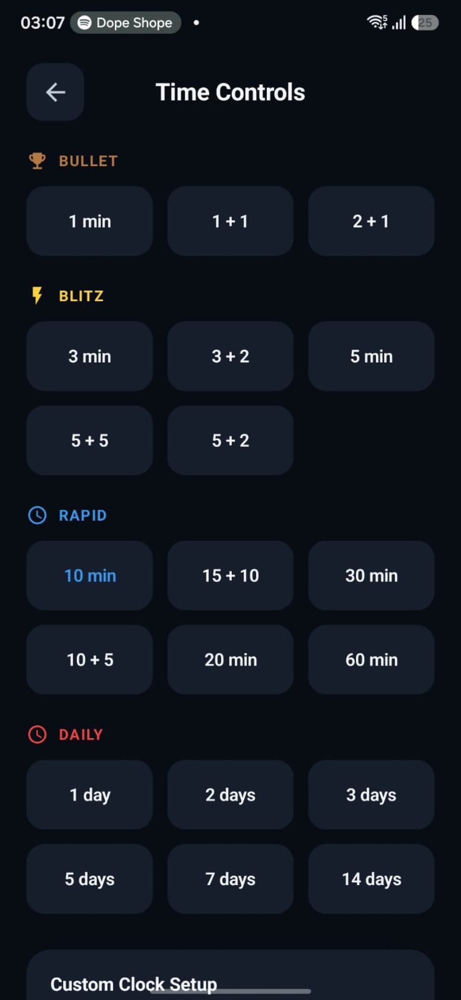</td>
    <td align="center">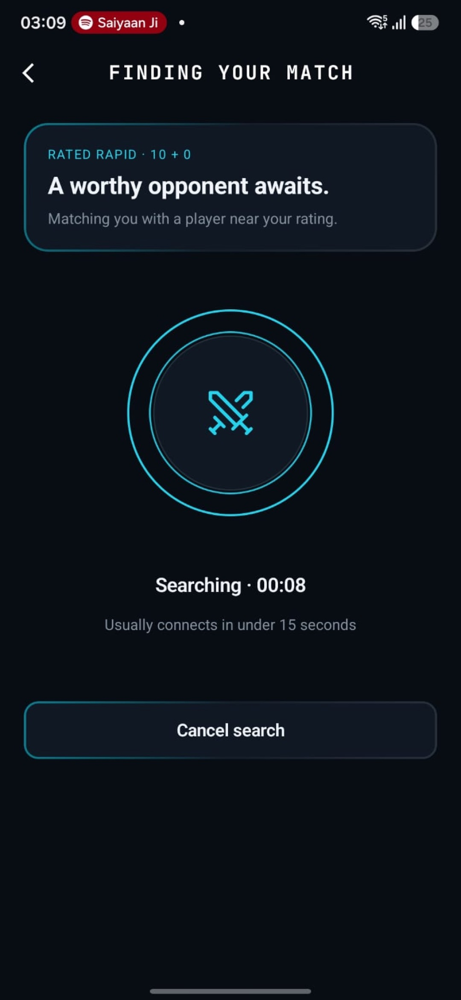</td>
  </tr>
  <tr>
    <td align="center"><sub><b>Home</b><br/>Rating overview, Quick Play and daily tactics</sub></td>
    <td align="center"><sub><b>New game</b><br/>Start a match, play friends, bots, pass &amp; play or tournaments</sub></td>
    <td align="center"><sub><b>Time controls</b><br/>Bullet, Blitz, Rapid, Daily or a custom clock</sub></td>
    <td align="center"><sub><b>Matchmaking</b><br/>Find a rated opponent in seconds</sub></td>
  </tr>
</table>

### On the board

<table>
  <tr>
    <td align="center">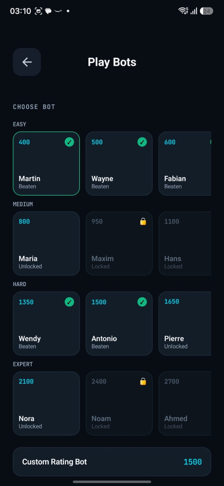</td>
    <td align="center">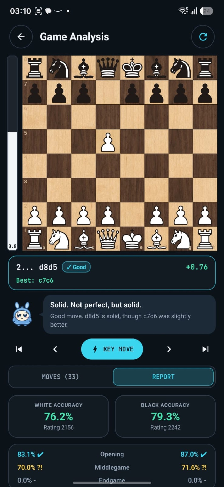</td>
    <td align="center">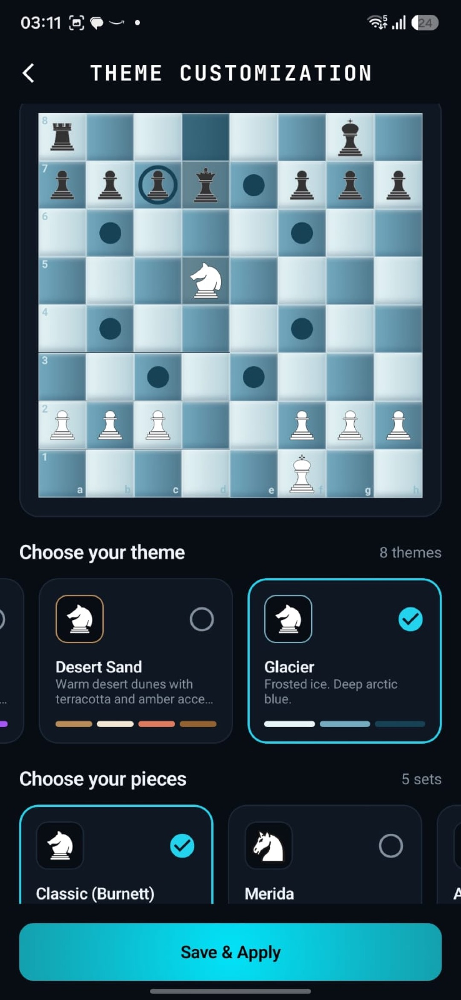</td>
  </tr>
  <tr>
    <td align="center"><sub><b>Bots</b><br/>A ladder of rated bots plus a custom rating bot</sub></td>
    <td align="center"><sub><b>Analysis</b><br/>Evaluation bar, accuracy, key moves and mascot feedback</sub></td>
    <td align="center"><sub><b>Themes</b><br/>8 board themes and 5 piece sets with live preview</sub></td>
  </tr>
</table>

### Puzzles and training

<table>
  <tr>
    <td align="center">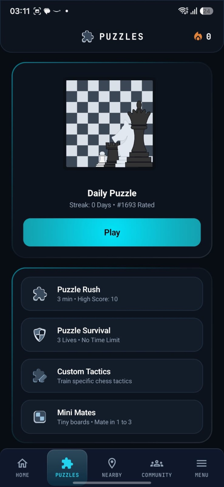</td>
    <td align="center">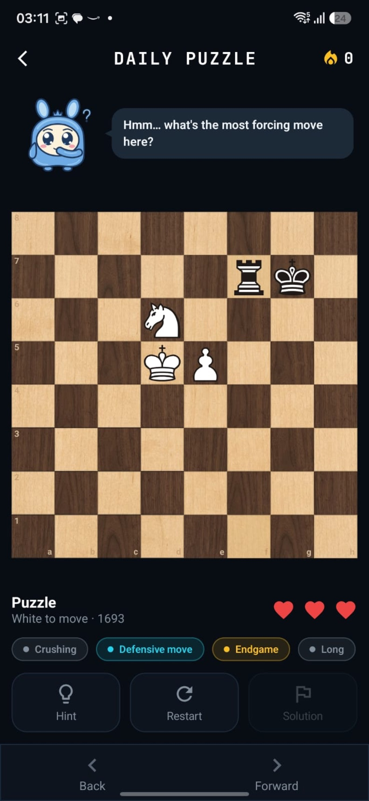</td>
    <td align="center">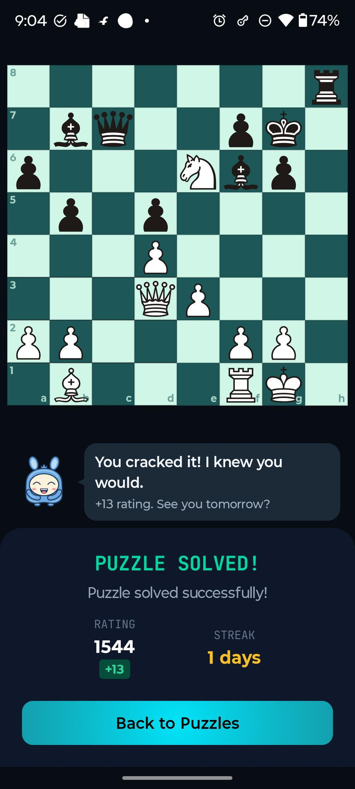</td>
    <td align="center">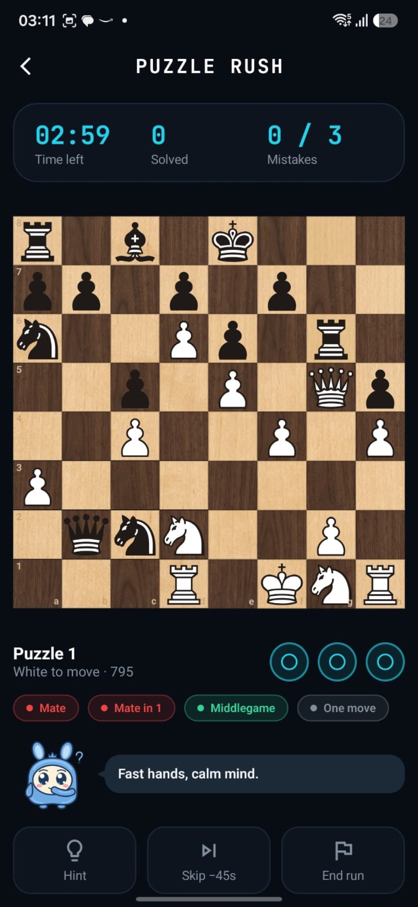</td>
    <td align="center">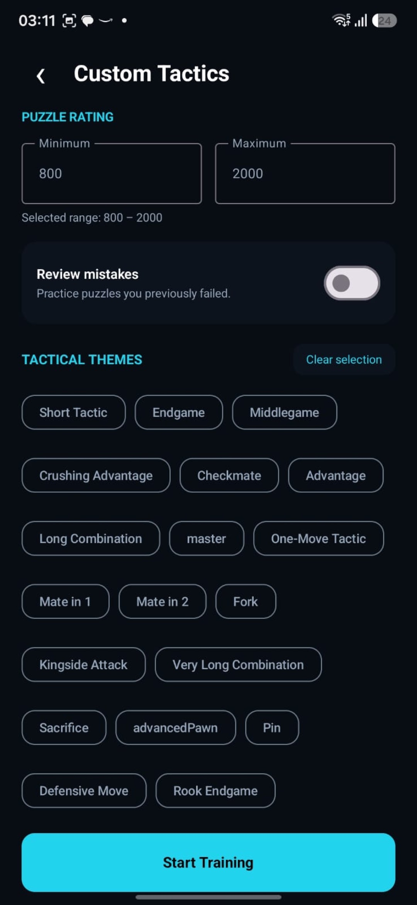</td>
  </tr>
  <tr>
    <td align="center"><sub><b>Puzzles hub</b><br/>Daily puzzle, Rush, Survival, Custom Tactics and Mini Mates</sub></td>
    <td align="center"><sub><b>Daily puzzle</b><br/>Hints, solutions, lives and a streak</sub></td>
    <td align="center"><sub><b>Puzzle solved</b><br/>Rating gain, streak update and mascot celebration</sub></td>
    <td align="center"><sub><b>Puzzle Rush</b><br/>Solve as many as you can before three strikes</sub></td>
    <td align="center"><sub><b>Custom tactics</b><br/>Pick tactical themes and a rating range</sub></td>
  </tr>
</table>

### Community

<table>
  <tr>
    <td align="center">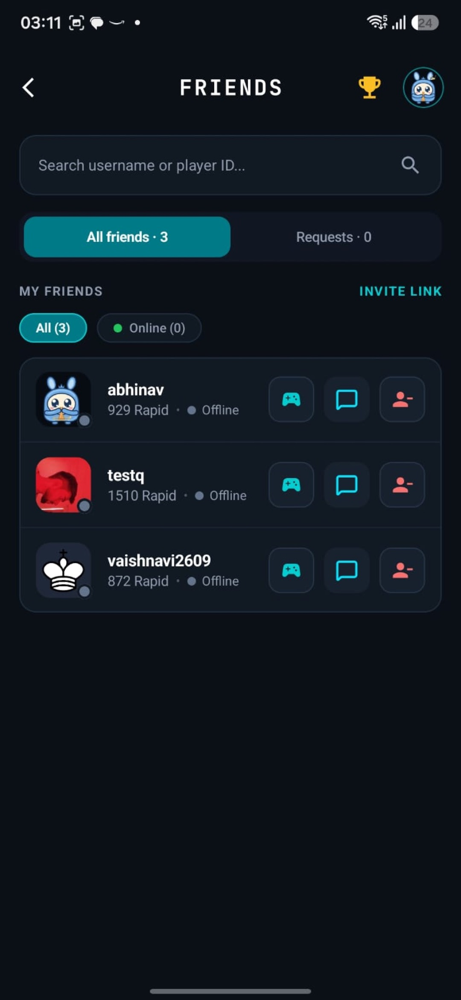</td>
    <td align="center">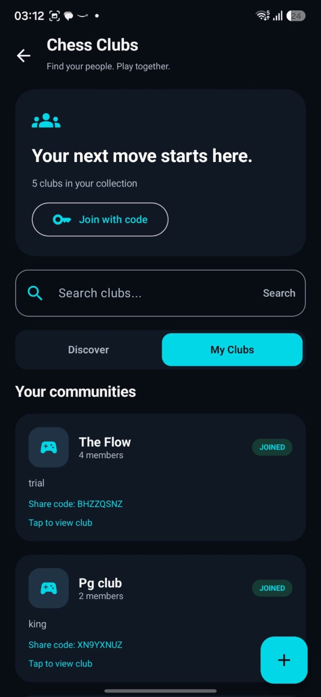</td>
    <td align="center">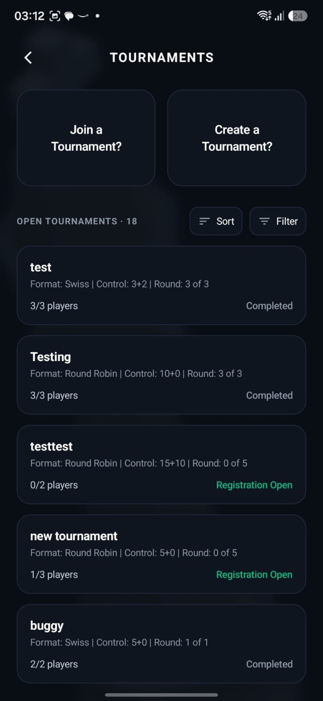</td>
    <td align="center">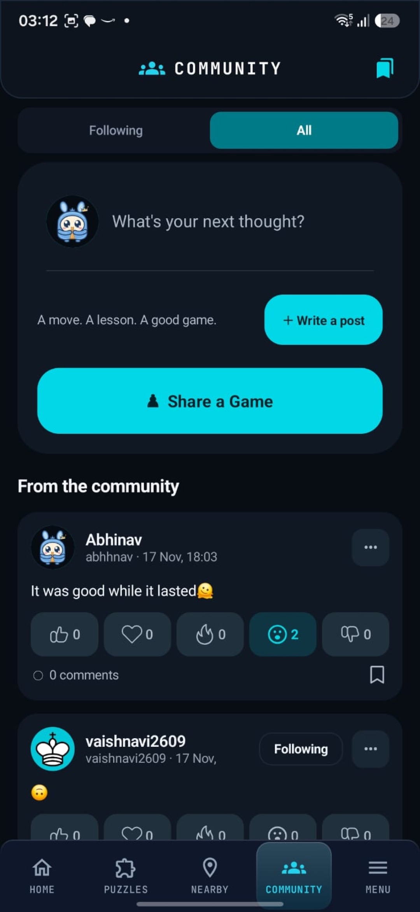</td>
  </tr>
  <tr>
    <td align="center"><sub><b>Friends</b><br/>Search, invite links, direct chat and challenges</sub></td>
    <td align="center"><sub><b>Clubs</b><br/>Discover, join with a code and browse your communities</sub></td>
    <td align="center"><sub><b>Tournaments</b><br/>Browse, sort, filter and join or create events</sub></td>
    <td align="center"><sub><b>Community</b><br/>Posts, shared games, reactions and comments</sub></td>
  </tr>
</table>

### Profile and widgets

<table>
  <tr>
    <td align="center">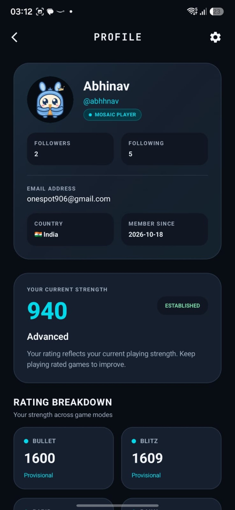</td>
    <td align="center">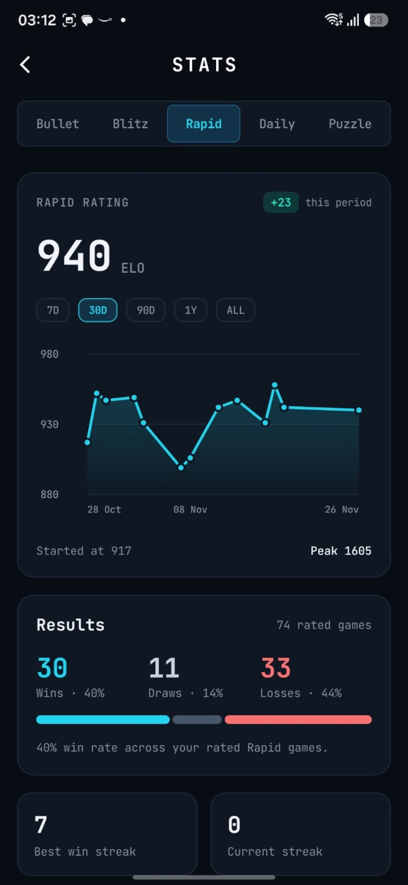</td>
    <td align="center">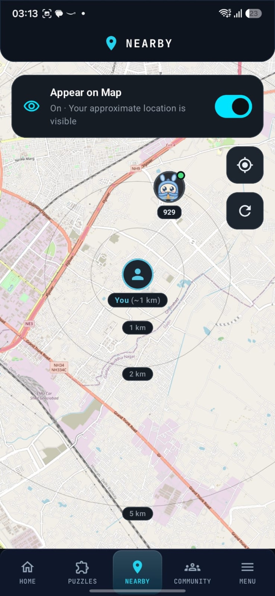</td>
    <td align="center">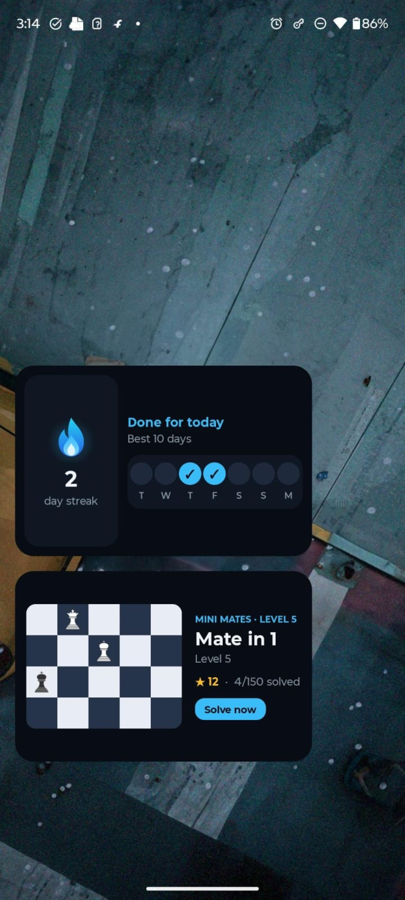</td>
  </tr>
  <tr>
    <td align="center"><sub><b>Profile</b><br/>Followers, country, current strength and rating breakdown</sub></td>
    <td align="center"><sub><b>Statistics</b><br/>Rating progression, win/draw/loss results and streaks</sub></td>
    <td align="center"><sub><b>Nearby</b><br/>Find players around you on an opt-in map</sub></td>
    <td align="center"><sub><b>Widgets</b><br/>Home screen streak and Mini Mates widgets</sub></td>
  </tr>
</table>

## Features

| Area | What it does |
| --- | --- |
| Online play | Rated matchmaking over WebSockets with Bullet, Blitz, Rapid and Classical time controls, custom clocks, draw offers, resignation, rematches, in-game chat with quick messages and a live ping indicator. |
| Daily games | Longer-form games you can move in at your own pace, with a home screen widget that shows the games waiting for your move. |
| Bots | A ladder of rated bots that unlock as you beat them, with a custom rating bot and a bot game history. |
| Pass and play | Two players on one device with an optional clock and auto-flip board. |
| Friends and invites | Friend requests, challenges, match links and QR codes, deep links that open straight into a game. |
| Spectating | Watch live games with a game code or link, with a spectator count and a list of active games. |
| Analysis | Post-game analysis with an evaluation graph, accuracy, best-move hints, key moves and move-by-move navigation. |
| Puzzles | Daily puzzle with hints and a streak, Puzzle Rush with strikes, Survival, Mini Mates levels and custom tactics filtered by theme and rating. |
| Tournaments | Create public or private tournaments in Swiss, Round Robin or Knockout formats, join with an invite code, and follow standings, rounds and pairings. Filter and sort the list. |
| Clubs | Create or join clubs with a share code, club chat, a leaderboard per time control, and tools for admins to promote, remove or ban members. |
| Community | A feed of posts and shared games with reactions and comments, plus follow and followers. |
| Messaging | Direct messages, blocked players and privacy settings for who can message or invite you. |
| Nearby | An optional map of nearby players using approximate location, off unless you choose to appear. |
| Profile and stats | Ratings by format, rating graph, win, draw and loss breakdown, performance by colour, avatars, country and a daily streak. |
| Customisation | 8 board themes (including wood textures and neon), 5 piece sets, move sounds and auto-promote to queen. |
| Widgets | Glance widgets for Daily Games, Streak, Quick Play and Mini Mates. |
| Notifications | Firebase push for challenges, friend requests and game updates, with per-type notification settings. |
| Mascot | A mascot that reacts to puzzle results, streaks, analysis and game outcomes. |
| Safety and privacy | Token refresh with session-expiry handling, secure screens, tilt-break suggestions from the server, reporting, an admin moderation panel and in-app account deletion. |
| Guest mode | Try the app as a guest, then sign up to keep progress across devices. |

## Architecture

The app is a single Gradle module. Screens are written in Jetpack Compose and backed by ViewModels that expose UI state. Repositories sit between the ViewModels and the data sources, and a chess engine abstraction handles rules locally for pass and play and move validation.

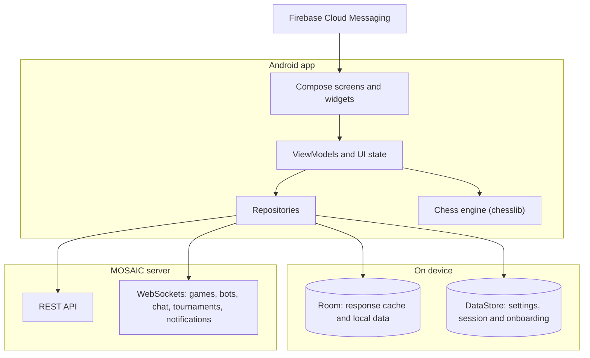

- **Layered by feature:** shared code lives in `core`, `data`, `domain` and `presentation`, while self-contained features such as puzzles, Mini Mates, widgets, the mascot and theme customisation live in `features/<feature>/`.
- **Real time:** live games, bot games, club chat, direct messages, tournaments and notifications each use their own WebSocket client, with OkHttp ping intervals to keep connections alive.
- **Resilient networking:** an auth interceptor attaches the access token, a token authenticator refreshes it when it expires, and cached responses are shown with an offline banner when the network is unavailable.
- **Navigation:** Navigation Compose split into focused graphs (`auth`, `home`, `game`, `puzzles`, `social`, `clubs`, `tournaments`, `profile`, `settings`, `admin`), with deep links for `caisarra://` and `https://caisaara.app` paths such as `/play/`, `/game/`, `/watch/`, `/tournament/` and `/club/`.

## Tech stack

| Layer | Technology |
| --- | --- |
| Language and UI | Kotlin 2.2, Jetpack Compose, Material 3, Navigation Compose, Coil |
| State | ViewModel, Kotlin coroutines and flows |
| Local data | Room, DataStore Preferences |
| Networking | Retrofit, OkHttp (REST and WebSockets), kotlinx.serialization |
| Chess | [chesslib](https://github.com/bhlangonijr/chesslib) for move generation and rules |
| Device features | CameraX with ML Kit barcode scanning and ZXing for QR codes, Play Services Location, osmdroid maps, uCrop for avatars |
| Widgets | Jetpack Glance App Widgets |
| Notifications | Firebase Cloud Messaging |
| Build | Gradle Kotlin DSL, version catalog, KSP, Android Gradle Plugin 9.3 |

## Project structure

```text
Caisarra/
├── build.gradle.kts
├── settings.gradle.kts
├── gradle/libs.versions.toml # dependency versions
└── app/
    ├── build.gradle.kts
    └── src/main/
        ├── AndroidManifest.xml
        ├── res/ # drawables, fonts, sounds, widget configs
        └── java/com/abhinav/caisarra/
            ├── app/ # Application, MainActivity, notification helper
            ├── core/ # database cache, network state, theme, shared UI, Glance
            ├── data/ # local stores, Retrofit services, sockets, repositories
            ├── domain/chess/ # engine, game clock, models and move parsing
            ├── features/ # puzzles, mini mates, widgets, mascot, themes, follow...
            └── presentation/ # screens, ViewModels, navigation graphs, game UI
```

## Getting started

### Prerequisites

- Android Studio (latest stable) with the Android SDK for API 37
- JDK 11 or newer (Gradle can download a matching toolchain)
- An Android device or emulator running Android 8.0 (API 26) or newer
- A Firebase project for push notifications

### Setup

```bash
git clone https://github.com/<your-username>/<your-repo>.git
cd <your-repo>
```

In the Firebase console, add an Android app with the package name `com.abhinav.caisarra` and download `google-services.json` into the `app/` folder. The Google Services plugin needs this file to build.

Open the project in Android Studio and let Gradle sync.

Choose a device and press Run, or build from the command line:

```bash
./gradlew assembleDebug # build a debug APK
./gradlew installDebug # install on a connected device
```

### Backend

The server URL is defined once in `data/remote/RetrofitInstance.kt` (`BASE_URL`). Point it at your own MOSAIC server to run against a different backend. WebSocket connections are built from the same base URL.

### Release build

```bash
./gradlew assembleRelease
```

Sign the build with your own keystore before publishing.

## Links

- Website: [caisaara.app](https://caisaara.app/)
- Author: Abhinav Pal
